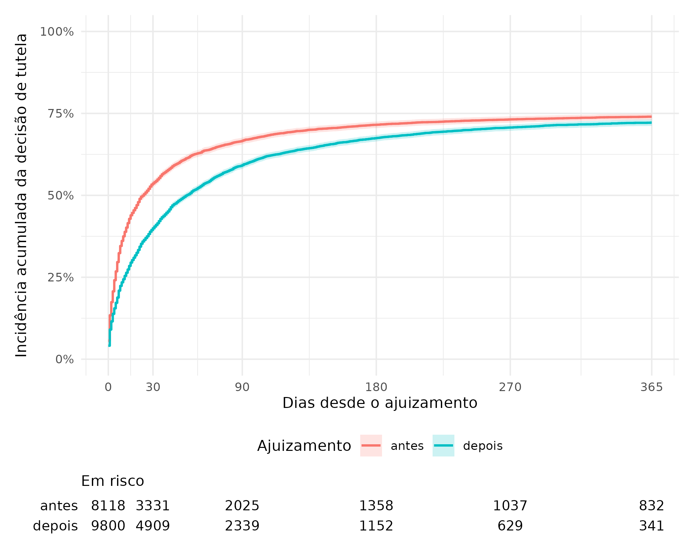
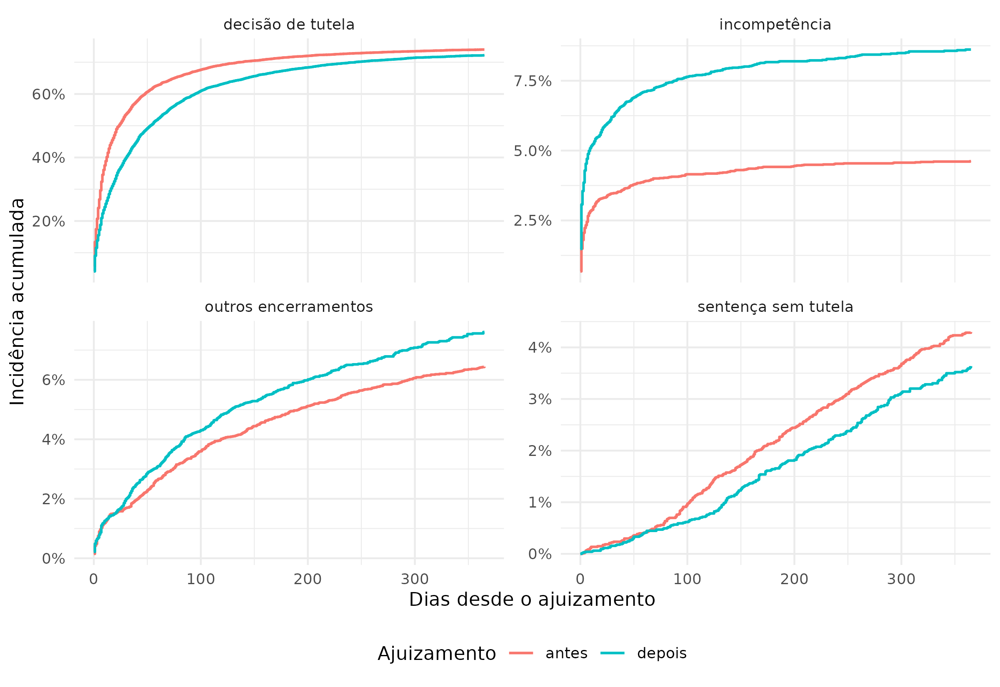

```{r}
library(tidyverse)
library(knitr)

res <- "resultados"
ler <- \(x) read_csv(file.path(res, x), show_col_types = FALSE)

pct <- scales::label_percent(accuracy = 0.1, decimal.mark = ",", big.mark = ".")
num <- scales::label_number(big.mark = ".", decimal.mark = ",")
num2 <- scales::label_number(accuracy = 0.01, decimal.mark = ",")
fmt_p <- \(p) if_else(p < 0.001, "< 0,001", format(round(p, 3), nsmall = 3, decimal.mark = ","))

contagem <- ler("contagem_eventos.csv")
tribunais <- ler("contagem_tribunais.csv")
cif <- ler("cif_horizontes.csv")
gray <- ler("teste_gray.csv")
modelos <- ler("modelos.csv")
zph <- ler("cox_zph.csv")
por_tribunal <- ler("cox_por_tribunal.csv")
resultado_tutela <- ler("resultado_tutela.csv")

n_total <- sum(contagem$antes) + sum(contagem$depois)
n_tribunais <- nrow(tribunais)

cif_tutela <- cif |> filter(outcome == "decisão de tutela")
valor_cif <- \(periodo, t) cif_tutela |> filter(strata == periodo, time == t) |> pull(estimate) |> pct()

fg <- modelos |> filter(modelo == "Fine-Gray")
cs <- modelos |> filter(modelo == "Cox causa-específico")
```

## Pergunta

Quanto tempo passa entre o ajuizamento de uma ação de fornecimento de medicamento não padronizado e a primeira decisão sobre o pedido de tutela de urgência? Esse tempo mudou nas ações ajuizadas depois do Tema 1234 do STF?

## Dados e método

- **Fonte:** API pública do DataJud (CNJ), índices de primeiro grau dos 27 tribunais de justiça estaduais, coletados com o pacote `datajud`.
- **Recorte:** assunto 12495 da TPU (fornecimento de medicamento não padronizado), classe procedimento comum cível (código 7), ajuizamento a partir de 01/01/2022. Ficaram `r num(n_total)` processos de `r n_tribunais` tribunais. A coleta não filtrou a classe, que foi aplicada depois, exceto no TJMG e no TJRS. Nesses dois, o índice só respondeu a consultas já restritas à classe 7, divididas por município do órgão julgador.
- **Marco:** 19/09/2024, data da publicação da ata do julgamento do Tema 1234, fixada pelo STF como parâmetro para as novas regras de competência. O período de cada processo depende da data de ajuizamento.
- **Evento de interesse:** primeiro movimento de decisão sobre antecipação de tutela ou liminar, seja concessão, concessão parcial ou indeferimento (códigos 332, 889, 785, 339, 892 e 792).
- **Riscos concorrentes:** desfechos que impedem a decisão de tutela no processo, ou seja, incompetência (sem decisão de tutela posterior), sentença de mérito sem tutela prévia e outros encerramentos (acordo, desistência, perda do objeto, óbito e extinção sem mérito).
- **Censura:** processos sem nenhum desses movimentos até a última atualização no DataJud.
- **Análise:** incidência acumulada de Aalen–Johansen por período, com teste de Gray. Para resumir o efeito do período, usamos um modelo de Cox causa-específico (estratificado por tribunal) e um modelo de Fine–Gray (com tribunal como covariável).

## Resultados

```{r}
#| label: tbl-eventos
#| tbl-cap: "Desfecho observado por período de ajuizamento"
contagem |>
  mutate(evento = if_else(evento == "tutela", "decisão de tutela", evento)) |>
  arrange(desc(antes + depois)) |>
  kable(col.names = c("Desfecho", "Antes", "Depois"), format.args = list(big.mark = "."))
```

Antes do Tema 1234, `r valor_cif("antes", 30)` dos processos já tinham decisão de tutela em 30 dias. Depois, essa proporção caiu para `r valor_cif("depois", 30)`. Em 90 dias, os valores foram `r valor_cif("antes", 90)` e `r valor_cif("depois", 90)`. A diferença diminui com o tempo: em um ano, as incidências são `r valor_cif("antes", 365)` e `r valor_cif("depois", 365)` (@fig-tutela).

{#fig-tutela width=90%}

```{r}
#| label: tbl-cif
#| tbl-cap: "Incidência acumulada da decisão de tutela (IC 95%)"
cif_tutela |>
  mutate(valor = str_glue("{pct(estimate)} ({pct(conf.low)} a {pct(conf.high)})")) |>
  select(time, strata, valor) |>
  pivot_wider(names_from = strata, values_from = valor) |>
  kable(col.names = c("Dias", "Antes", "Depois"))
```

```{r}
p_gray <- gray |> select(starts_with("outcome"), starts_with("p.value")) |>
  pivot_longer(everything(), names_to = c(".value", "i"), names_pattern = "(.*)_(\\d)") |>
  filter(outcome == "decisão de tutela") |> pull(p.value)
```

O teste de Gray rejeita a igualdade das curvas de incidência da decisão de tutela (p `r if (p_gray < 0.001) "<" else "="` `r str_remove(fmt_p(p_gray), "< ")`).

No modelo de Fine–Gray, a razão de subdistribuição para o período posterior foi `r num2(fg$estimate)` (IC 95%: `r num2(fg$conf.low)` a `r num2(fg$conf.high)`). Isso indica uma incidência menor de decisão de tutela ao longo do tempo. No Cox causa-específico, a razão de taxas foi `r num2(cs$estimate)` (`r num2(cs$conf.low)` a `r num2(cs$conf.high)`). Porém o teste de Schoenfeld rejeita a proporcionalidade (p `r if (zph$p[1] < 0.001) "<" else "="` `r str_remove(fmt_p(zph$p[1]), "< ")`): o efeito se concentra nas primeiras semanas. Por isso, a leitura principal deve vir das incidências em horizontes fixos, e não de uma razão única.

{#fig-desfechos width=100%}

A incompetência ganha peso depois do marco (@fig-desfechos). Isso é coerente com o deslocamento de parte das ações para a Justiça Federal previsto no Tema 1234.

```{r}
#| label: tbl-tutela
#| tbl-cap: "Resultado da primeira decisão de tutela"
resultado_tutela |>
  mutate(valor = str_glue("{num(n)} ({pct(prop)})")) |>
  select(periodo, tutela, valor) |>
  pivot_wider(names_from = periodo, values_from = valor) |>
  kable(col.names = c("Decisão", "Antes", "Depois"))
```

```{r}
negada <- \(per) resultado_tutela |> filter(periodo == per, tutela == "negada") |> pull(prop) |> pct()
```

Entre as decisões de tutela, a proporção de indeferimentos passou de `r negada("antes")` para `r negada("depois")` (@tbl-tutela).

```{r}
#| label: tbl-tribunal
#| tbl-cap: "Razão de taxas (Cox causa-específico) do período posterior, por tribunal com ao menos 100 processos em cada período"
por_tribunal |>
  mutate(across(c(estimate, conf.low, conf.high), num2),
         p.value = fmt_p(p.value)) |>
  kable(col.names = c("Tribunal", "Razão", "IC inf.", "IC sup.", "p"))
```

```{r}
n_menor <- sum(por_tribunal$conf.high < 1)
n_maior <- sum(por_tribunal$conf.low > 1)
```

O efeito não é uniforme (@tbl-tribunal). Em `r n_menor` tribunais, a taxa de decisão de tutela caiu de forma significativa depois do marco. Em `r n_maior`, ela aumentou, e nos demais a diferença não é significativa.

## Limitações

- O DataJud não informa se houve pedido de tutela. Processos sem pedido aparecem como censurados ou terminam em outro desfecho, o que reduz a incidência nos dois períodos.
- Os movimentos 12444 e 12455 ("deferimento" e "indeferimento", sem complemento) ficaram fora do evento, porque também registram outras decisões, como a gratuidade da justiça.
- A classe e o órgão informados são os atuais. Processos remetidos à Justiça Federal podem sair do índice estadual, e o DataJud omite os processos sigilosos.
- O período posterior tem seguimento mais curto. As estimativas em horizontes longos dependem sobretudo dos processos ajuizados antes do marco.
- O número de processos ajuizados entre 2022 e 2024 é menor que o do período posterior, o que pode indicar cobertura incompleta do DataJud para os anos mais antigos.
- O mesmo movimento pode ser lançado de maneiras diferentes em cada tribunal. Por isso, os modelos levam o tribunal em conta.

```{r}
#| results: asis
meta <- readLines(file.path(res, "metadados.txt"))
cat("\n*Base:", paste(meta, collapse = "; "), "*\n")
```
